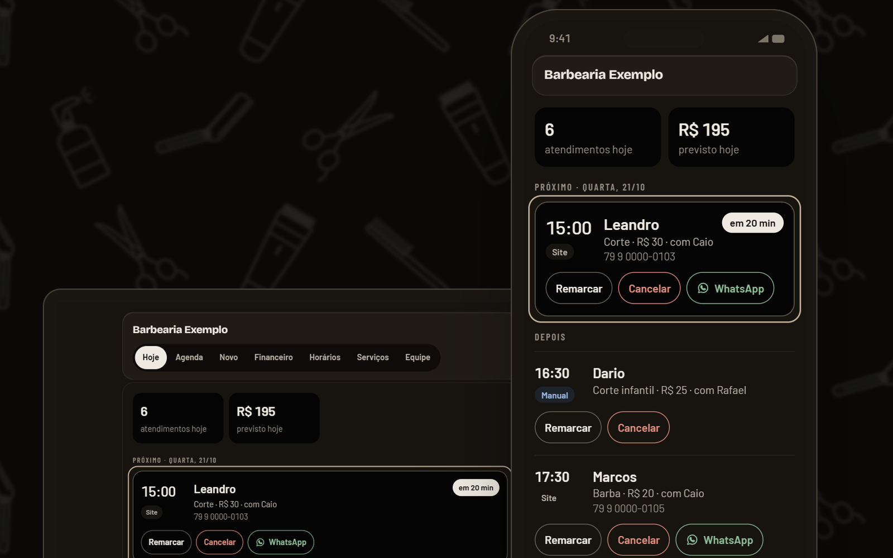

# Site Agenda Web Pro

**A vitrine do produto, com o sistema funcionando dentro da página.**

Site de apresentação do [Agenda Web Pro](https://github.com/AdrianDoriaTI/agenda-web-pro), uma agenda online para barbearias. Em vez de prometer, a página mostra o sistema rodando: o cliente escolhendo horário, o painel do barbeiro e o financeiro do dia, tudo com dados fictícios da "Barbearia Exemplo".

### [→ Ver ao vivo](https://www.agendawebpro.com.br/site/barbearias/)


## O que tem aqui

- **Demonstração interativa** do painel em notebook e celular, com troca de telas (Hoje, Agenda, Financeiro)
- **Tema claro e escuro**, que segue o sistema e pode ser trocado na página
- **Mobile-first**, validado em 375, 768 e 1440 px
- **Segurança no deploy:** Content-Security-Policy rígida, HSTS e demais cabeçalhos gerados no build (`scripts/headers.mjs`)
- **Leve:** HTML estático, JavaScript só onde há interação, fontes locais



## Stack

| | |
|---|---|
| Framework | [Astro](https://astro.build) + TypeScript |
| Estilo | Tailwind CSS v4 |
| Hospedagem | Cloudflare Workers (arquivos estáticos) |

## Como rodar

```bash
npm install
npm run dev      # http://localhost:4321
npm run build    # gera dist/ com redirecionamentos e cabeçalhos
```

## Estrutura

```
src/
  components/        seções da página
  components/demo/   a demonstração (notebook, celular, telas do painel)
  config/site.ts     marca, links e chamadas para ação
scripts/             pós-build: redirecionamentos e cabeçalhos de segurança
```

## Sobre

Feito por [Adrian Doria](https://adrian-doria-portfolio.vercel.app), do design ao código.
O número de WhatsApp neste repositório é de exemplo.
